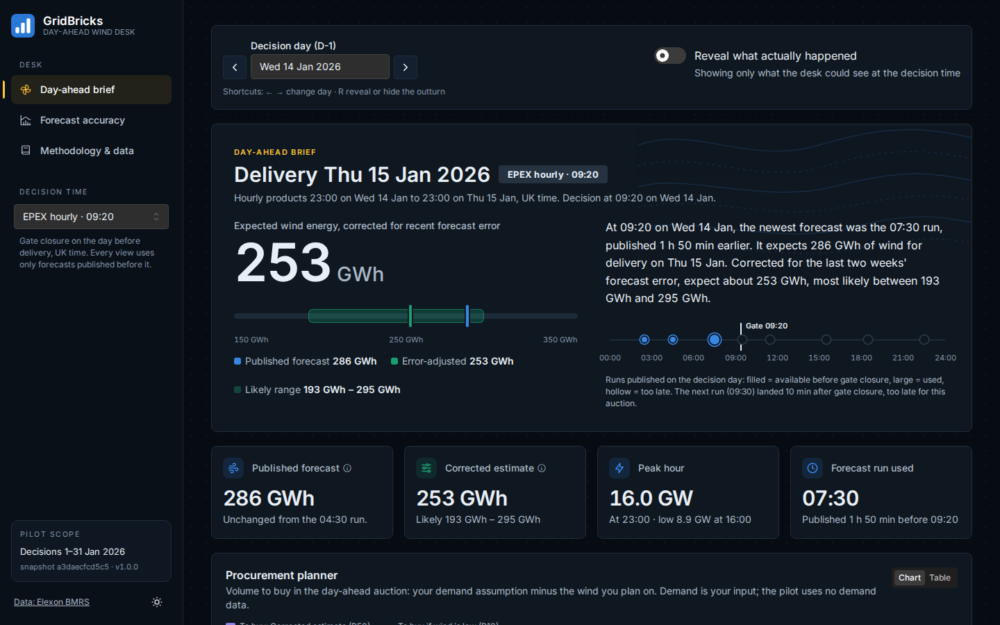
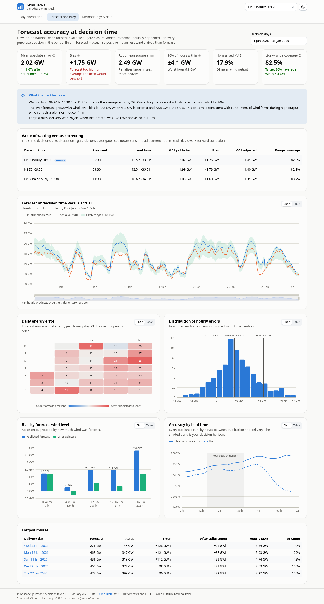
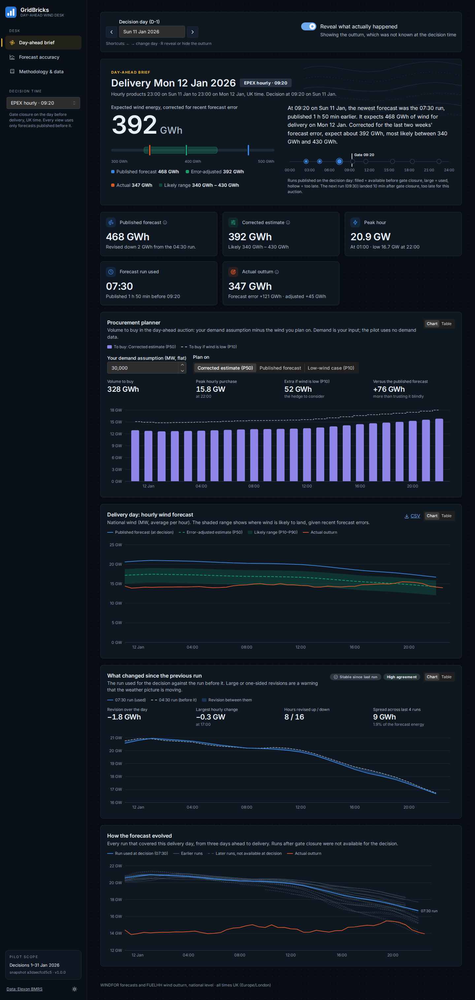
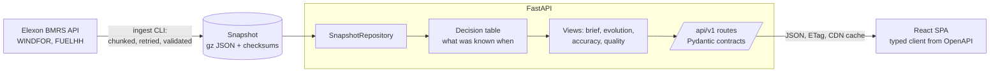

# GridBricks · Day-Ahead Wind Desk

A pilot web app for a GB energy utility's day-ahead trading desk. For every purchase decision in
January 2026 it shows **the national wind forecast that was actually available at gate closure**,
and **how accurate that forecast turned out to be**, with an honest error range the desk can plan
around.

| | |
|---|---|
| **Live app** | `TODO: add the Vercel URL after deployment` |
| **Video walkthrough** | `TODO: add the unlisted YouTube link` |
| **API reference** | `/api/docs` on any running instance (OpenAPI) |



| Forecast accuracy | Brief with the outturn revealed |
|---|---|
|  |  |

The interface is a dark "control room" by default, with a light theme one click away in the
sidebar. It uses Apple's San Francisco typeface throughout (Inter, bundled, on other systems), a
left rail with the GridBricks bar mark, a single amber signal colour for interface state, a
dot-grid canvas and a wind-streamline motif. Chart colours are kept separate from that chrome:
forecast blue, actual orange and corrected aqua, validated for colour-blind readers on both
themes.

## Assignment checklist

| Requirement from the brief | Where it is met |
|---|---|
| Show the latest renewable forecast available when the day-ahead purchase decision is made | Day-ahead brief: newest WINDFOR run strictly before the chosen auction's gate closure on D-1, with a run timeline, for EPEX 09:20, N2EX 09:50, EPEX 15:30 or any custom time |
| Evaluate forecast accuracy quantitatively, so decisions can account for the error | Forecast accuracy page (MAE, RMSE, bias, percentiles, lead time, wind level, daily energy error) and a walk-forward P10–P90 range on every brief |
| Understand how much power to procure beyond renewables | Procurement planner on the brief |
| National wind only: FUELHH `fuelType=WIND` actuals and WINDFOR forecasts | `backend/src/gridbricks/elexon/`, snapshot in `backend/data/snapshot/` |
| Data for purchase decisions made in January 2026 | Decision days 1–31 Jan 2026 (delivery 2 Jan to 1 Feb); late December used only to calibrate early-January ranges |
| React frontend, Python backend | `frontend/` (React 19, TypeScript), `backend/` (FastAPI, Python 3.12) |
| Docker | `Dockerfile`, `docker-compose.yml`; CI runs the browser tests against the image |
| Deployed on Vercel or Heroku | Vercel config in `vercel.json` and `api/index.py`; live link at the top of this README |
| README with files and directories, how to start, app link | [Repository layout](#repository-layout), [Quick start](#quick-start), links table above |
| AI tools mentioned | [Use of AI tools](#use-of-ai-tools) |

## What the desk gets

1. **Day-ahead brief.** Pick a decision day and an auction. The brief shows which forecast run
   had landed before gate closure and what it said for each hourly product. It adds an
   error-adjusted estimate with a P10–P90 likely range, and shows how the forecast evolved
   before and after the decision. A toggle reveals what actually happened.
   - **Procurement planner.** Turns the wind outlook into the decision itself: enter a demand
     assumption and choose to plan on the published forecast, the corrected estimate or the
     low-wind (P10) case. It shows the volume to buy per hourly product, the peak purchase, the
     extra volume a low-wind day would need, and how far the published forecast would have
     under-bought. Demand is the user's input; the pilot uses no data beyond Elexon wind.
   - **Run-to-run revisions.** The run used against the run before it, with the gap shaded, a
     revision alert when the day moves by 10 GWh or any hour by 1 GW, and an agreement score
     across the last four runs. These follow features of trading forecast tools such as
     Meteomatics and AG2 Trader, where a small gap between runs signals a confident forecast.
   - **Keyboard shortcuts.** ← and → step through days; R reveals or hides the outturn.
2. **Forecast accuracy.** A backtest of every January decision: error metrics, daily misses,
   error distribution, bias by wind level, accuracy by lead time, and the value of waiting for a
   later auction compared with correcting the forecast. An hour-by-day error heatmap shows when
   misses cluster, and the daily table downloads as CSV.
3. **Methodology and data.** Definitions, the calibration method, data provenance with
   checksums, and data-quality findings.

The January 2026 backtest at the 09:20 EPEX gate (744 hourly products):

| Measure | Value |
|---|---|
| Mean absolute error | 2.02 GW |
| Bias (forecast − actual) | +1.75 GW, a systematic over-forecast that leaves the desk short |
| Daily energy error, published forecast | 43.3 GWh |
| Daily energy error after the walk-forward correction | 22.4 GWh (−48%) |
| Mean absolute error after the correction | 1.24 GW (−39%) |
| Actual hours inside the P10–P90 range | 80.1% (target 80%) |
| Gain from waiting until the 15:30 auction | −7% error |

## Quick start

**Docker (recommended).** One container serves the API and the web app.

```bash
docker compose up --build        # then open http://localhost:8000
```

**Local development.** This needs Python 3.12 with [uv](https://docs.astral.sh/uv/), and
Node 22 or newer.

```bash
make setup     # install backend and frontend dependencies
make dev       # API on :8000 and web on :5173, both with hot reload
```

**Checks.**

```bash
make check     # lint, strict types, 105 backend + 64 frontend tests with coverage gates
make up        # production container on :8000, then in another shell:
make e2e       # 14 Playwright tests: smoke, accessibility (axe) and mobile
```

**Refresh the data snapshot** from the Elexon API. It is deterministic and checksummed.

```bash
make ingest
```

Run `make` on its own to list every target.

## Repository layout

| Path | What it contains |
|---|---|
| `backend/` | Python 3.12 API (FastAPI, pandas). `pyproject.toml` and `uv.lock` pin every dependency. |
| `backend/src/gridbricks/domain/` | Pure business rules with no I/O: market timings, forecast selection, metrics, calibration and data-quality checks. |
| `backend/src/gridbricks/services/` | Builds the decision table and each view (brief, evolution, accuracy, quality). `desk.py` is the facade the API calls. |
| `backend/src/gridbricks/api/` | HTTP layer: routes, dependencies, problem+json errors, and middleware for request IDs, security headers and caching. |
| `backend/src/gridbricks/elexon/` | Elexon BMRS client (chunked, retried, validated) and record models. |
| `backend/src/gridbricks/ingest.py` | `python -m gridbricks.ingest`, which builds the data snapshot. |
| `backend/src/gridbricks/schemas.py` | Response models: the API contract, which is also the source of the frontend types. |
| `backend/data/snapshot/` | Committed January 2026 data: gzipped JSON plus `manifest.json` with checksums. |
| `backend/tests/` | Unit, property-based, leakage, integration and golden tests. |
| `frontend/` | React 19 + TypeScript app (Vite, Mantine, ECharts, TanStack Query). |
| `frontend/src/features/` | One folder per page: `brief`, `accuracy`, `methodology`. |
| `frontend/src/api/` | Typed API client; `schema.d.ts` is generated from `openapi.json`. |
| `frontend/src/lib/` | UK-time formatting, URL state, chart theme and headline text. |
| `frontend/e2e/` | Playwright smoke, accessibility (axe), mobile and screenshot specs. |
| `docs/testing.md` | The test strategy: every test type, what it proves and how to run it. |
| `api/index.py` | Vercel serverless entry point that wraps the FastAPI app. |
| `Dockerfile`, `docker-compose.yml` | Multi-stage production image and local run. |
| `vercel.json`, `.vercelignore` | Vercel build, routing, function bundle and headers. |
| `heroku.yml` | Alternative container deployment to Heroku. |
| `requirements.txt` | Runtime dependencies exported from `backend/uv.lock`, used by Docker and Vercel. |
| `Makefile` | Developer commands. |
| `.github/workflows/ci.yml` | CI: backend, frontend, contract drift, Docker build and browser smoke tests. |
| `docs/` | Architecture guide, methodology, decision records (`docs/adr/`) and screenshots. |

## Architecture in one picture



The app never calls Elexon at runtime. It reads a committed, checksummed snapshot, so the demo
is reproducible and immune to upstream outages. The [architecture guide](docs/architecture.md)
covers layering, caching, testing and deployment. The [decision records](docs/adr/) explain the
trade-offs.

## Methodology in brief

- **Delivery day D** means the 24 hourly products from 23:00 on D-1 to 23:00 on D, UK time.
- **Decision time** is the auction gate closure on D-1. The presets are the EPEX hourly auction
  at 09:20, Nord Pool N2EX at 09:50 and the EPEX half-hourly auction at 15:30. A custom time is
  also allowed.
- **Available forecast** for each hour is the newest WINDFOR run published strictly before the
  decision time. Stale values that a run repeats for past hours are discarded.
- **Error** is forecast minus actual, using FUELHH `WIND` outturn. Positive means over-forecast,
  so the desk would be short.
- **Corrected estimate and range.** For each decision, a line actual ≈ a + b × forecast is fitted
  to every hour of the last 14 days whose outturn was already published at the decision time.
  It gives the corrected estimate, and its residual percentiles give the P10–P90 range. Late
  December 2025 is used as warm-up for early-January decisions. A leakage test proves no later
  information is used, and [ADR-0006](docs/adr/0006-linear-walk-forward-correction.md) compares
  the alternatives.

The full write-up is in [docs/methodology.md](docs/methodology.md).

## API

| Endpoint | Purpose |
|---|---|
| `GET /api/health` | Liveness and snapshot version |
| `GET /api/v1/meta` | Scope, gate presets, observed run schedule, snapshot manifest |
| `GET /api/v1/brief?decision_date=2026-01-14&gate=epex_hourly` | Day-ahead brief; add `cutoff=HH:MM` for a custom decision time |
| `GET /api/v1/brief.csv?...` | The brief's hourly products as CSV |
| `GET /api/v1/evolution?decision_date=...` | Every run covering the delivery day |
| `GET /api/v1/accuracy?gate=...&decision_from=...&decision_to=...` | Backtest metrics and breakdowns |
| `GET /api/v1/accuracy/horizon?gate=...` | Accuracy of all runs by lead time |
| `GET /api/v1/quality` | Data-quality checks |

All times are UTC (ISO 8601), power is in MW and energy in GWh. Errors use
`application/problem+json`.

## Deployment

**Vercel (live demo).** The project imports from GitHub with no settings to change, because
`vercel.json` defines the build. Vercel serves the React build from its CDN in London and runs
the FastAPI app as one Python function from `api/index.py`. API responses carry
`s-maxage=86400`, so the CDN serves repeat requests.

**Any container host.** The same `Dockerfile` runs on Heroku (`heroku.yml`), AWS App Runner,
Cloud Run or Kubernetes. It honours `$PORT`, runs as a non-root user and has a health check.

## Configuration

Every setting has a default and can be overridden with a `GRIDBRICKS_*` environment variable.
See `.env.example`.

| Variable | Default | Meaning |
|---|---|---|
| `GRIDBRICKS_ENVIRONMENT` | `development` | `production` enables HTTP caching |
| `GRIDBRICKS_FIRST_DECISION_DATE` / `GRIDBRICKS_LAST_DECISION_DATE` | 2026-01-01 / 2026-01-31 | Decision days in scope |
| `GRIDBRICKS_CALIBRATION_WINDOW_DAYS` | 14 | Settled days used to calibrate each range |
| `GRIDBRICKS_DATA_DIR` | `backend/data/snapshot` | Snapshot location |
| `GRIDBRICKS_STATIC_DIR` | unset | Serve the built SPA from FastAPI, as Docker does |
| `GRIDBRICKS_LOG_JSON` | `false` | JSON-lines logs |

## Engineering practices

- **Tests.** 183 automated tests across nine kinds; [docs/testing.md](docs/testing.md) explains
  each one.

  | Kind | Where | Count |
  |---|---|---|
  | Backend unit, incl. property-based selection and the no-look-ahead leakage test | `backend/tests/unit` | 65 |
  | API integration: contracts, errors, caching, security headers, SPA serving | `tests/integration/test_api.py` | 18 |
  | API fuzzing with Hypothesis: never a server error, always clean problem+json | `test_api_fuzz.py` | 1 property, 120 cases |
  | Contract: frontend's OpenAPI copy equals the served spec | `test_contract.py` | 2 |
  | Golden numbers and snapshot integrity on the real data | `test_snapshot_golden.py`, `test_snapshot_integrity.py` | 12 |
  | Performance budgets per endpoint | `test_performance.py` | 7 |
  | Frontend unit and component tests with real API fixtures (MSW) | `frontend/src/**/*.test.ts(x)` | 64 |
  | Accessibility: axe WCAG 2.1 AA on every page, dark and light | `frontend/e2e/a11y.spec.ts` | 6 |
  | End to end: smoke and mobile, run against the Docker image in CI | `frontend/e2e/*.spec.ts` | 8 |

  Coverage gates: backend 90% (currently 94%), frontend 80% of lines (currently 86%).
- **Typed end to end.** mypy runs in strict mode. Pydantic models generate OpenAPI, the
  TypeScript types are generated from it, and CI fails if they drift.
- **Quality gates.** ruff, ESLint (strict type-checked), Prettier, pre-commit hooks and CI on
  every push.
- **Operations.**
  - Structured JSON logs with request IDs.
  - Health endpoint and container health check.
  - Problem+json errors.
  - Security headers and a strict content security policy.
  - ETag and CDN caching.
  - 12-factor configuration and pinned lockfiles.
  - Dependabot.
- **Accessibility.** axe audits every page in both themes in CI. The chart palette is validated
  for colour-blind separation in light and dark mode. Every chart has a table view. Controls are
  keyboard-reachable, and every view is shareable through its URL.

## Use of AI tools

This project was built with substantial help from **Claude Code**, Anthropic's AI coding
assistant. It was used for:

- domain research, such as GB auction gate closures;
- exploring the Elexon data;
- architecture and code;
- tests and documentation.

The author directed the work and reviewed and verified the output, including every number quoted
above, which the golden tests pin.

## Limitations

- National wind only, not the client's portfolio or demand.
- Volumes only: no prices, so no cost of imbalance yet.
- The over-forecast may reflect curtailment. Confirming it needs balancing-mechanism data.

The roadmap is on the app's Methodology page and in [docs/methodology.md](docs/methodology.md).
