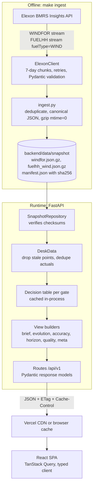
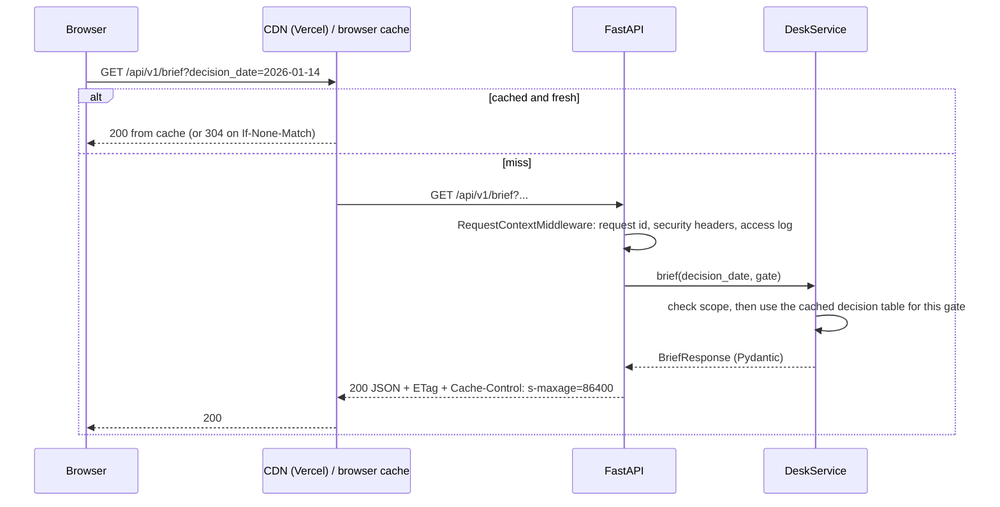
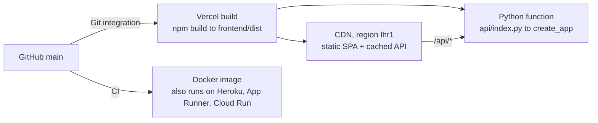

# Architecture

This guide is for engineers reviewing or extending the pilot. It explains how the system is
put together, why, and where to make changes.

## Goals that shaped the design

1. **Correct "what was known when."** Every number shown for a decision must use only information
   published before that decision. This is the single most important property, so it lives in
   one place and has its own tests.
2. **Reproducible and dependable.** A demo must not break because an upstream API is slow or
   changes, so the app runs on a checksummed snapshot.
3. **Easy to review and extend.** The code is layered, typed end to end and documented with
   decision records.
4. **Production habits at pilot scale.** These include CI, containers, structured logs, health
   checks, caching, security headers and accessibility, without heavy infrastructure.

## System overview

## Backend layers

The dependency rule points inward: routes call services, services call domain functions, and the
domain imports nothing from the outer layers.

| Layer | Path | Responsibility | Depends on |
|---|---|---|---|
| Domain | `gridbricks/domain/` | Market rules, as-of selection, metrics, calibration, data-quality checks. Pure functions over pandas and numpy, with no I/O. mypy strict. | nothing internal |
| Data access | `repository.py`, `elexon/`, `ingest.py` | The `DataRepository` protocol and snapshot implementation, the Elexon client and the ingest CLI. | domain column contracts |
| Services | `gridbricks/services/` | Build the decision table once per gate and project it into views. `DeskService` is the facade: it validates scope, caches tables and is thread-safe. | domain, repository, schemas |
| Contracts | `schemas.py` | Pydantic response models: the API contract and the source of the TypeScript types. | — |
| HTTP | `gridbricks/api/`, `main.py` | Thin routes, dependency injection, problem+json errors, middleware, and SPA serving in Docker. | services |

### The decision table

Every analytical view is a projection of one table, built per decision time by
`services/decision_table.py`:

| Column | Meaning |
|---|---|
| `delivery_date`, `start_time` | Delivery day D and the UTC start of each hourly product (23:00 D-1 to 23:00 D, UK) |
| `cutoff` | Gate closure on D-1 in UTC, computed in `Europe/London` so clock changes are handled |
| `publish_time`, `forecast_mw` | The newest run strictly before the cutoff that covers the hour (`merge_asof`, `allow_exact_matches=False`) |
| `previous_publish_time`, `previous_forecast_mw` | The run before it, used to show revisions |
| `horizon_h` | Lead time from publication to the hour |
| `actual_mw`, `error_mw` | FUELHH outturn for the half-hour starting at `start_time`; error = forecast − actual |
| `actual_published` | When that outturn was published: decides whether it was known at a later cutoff |
| `p10_mw`, `p50_mw`, `p90_mw` | Walk-forward linear correction and range. See [ADR-0006](adr/0006-linear-walk-forward-correction.md). |

The table covers the 14-day calibration warm-up plus every in-scope delivery day. The warm-up days
are never shown; they only calibrate early-January ranges.

### Request flow

### Caching

- **In-process.** Data loads once per process. Decision tables are built per gate closure, cached,
  and use about 1 ms per later request. The three presets are warmed at startup. Custom cutoffs
  share a bounded LRU cache.
- **HTTP.** The data is immutable within a deployment, so production responses carry
  `public, max-age=300, s-maxage=86400, stale-while-revalidate`. They also carry a weak ETag made
  from the app version and the snapshot hash. A matching `If-None-Match` is answered with 304
  before any work. Errors and `/api/health` are `no-store`.
- **Frontend.** TanStack Query uses `staleTime: Infinity` and keeps the previous data while
  refetching, so the charts dim rather than flash.

### Errors, logs and health

- Errors use RFC 9457 `application/problem+json` with a title, detail and request id. Scope
  violations return 422, unknown routes 404, and a missing or tampered snapshot 503.
- Logs come from structlog: JSON lines in production, one access-log line per request with
  method, path, status, duration and request id. An `X-Request-ID` sent by a caller is honoured.
- `/api/health` returns 503 with `status: degraded` if the snapshot is missing. The app still
  starts, which avoids crash loops. The Docker `HEALTHCHECK` uses this endpoint.

### Security

- No secrets: the Elexon API is public and the runtime makes no outbound calls.
- Every response gets a strict CSP (`default-src 'self'`), `X-Frame-Options: DENY`, `nosniff`,
  a referrer policy and a permissions policy. Swagger UI at `/api/docs` is exempt from the CSP.
- Query parameters are validated by type, with enums for gates and a pattern for cutoffs. Scope
  is checked in the service layer.
- The container runs as a non-root user. SPA file serving guards against path traversal, and a
  test covers it.

## Frontend

| Concern | Approach |
|---|---|
| Routing and state | React Router. Every control (date, gate, custom cutoff, reveal, range) lives in the URL, so views are shareable. |
| Server state | TanStack Query hooks in `src/api/queries.ts`. 4xx errors are not retried. |
| API contract | `openapi-typescript` generates `schema.d.ts` from the backend's OpenAPI. The `openapi-fetch` client is fully typed. CI regenerates both files and fails on any diff. |
| Charts | ECharts, tree-shaken to the five chart types used, with the SVG renderer. Option builders are pure functions in `chartOptions.ts` and `charts.ts`, unit-tested without a DOM. |
| Visual system | Mantine plus a small token layer in `styles.css`. Fixed entity colours: forecast blue, actual orange, adjusted aqua. The palette was validated for colour-blind separation in light and dark mode. |
| Time | Every instant is shown in UK time via `Intl` with `Europe/London`, whatever the viewer's timezone. Calendar dates are never shifted. |
| Accessibility | Every chart has a table view. There are ARIA labels, a skip link, keyboard-reachable controls and visible focus. |
| Resilience | An error boundary per page, problem+json messages with a retry action, and lazy-loaded secondary pages. |

## Testing strategy

| Level | Where | What it proves |
|---|---|---|
| Domain unit | `backend/tests/unit` | GMT/BST cutoffs and 23/25-hour days, strict gate semantics, metrics by hand, calibration windows, schedule inference |
| Property-based | `test_selection.py` | For any data, the chosen run is the latest one strictly before the cutoff (Hypothesis) |
| Leakage | `test_decision_table.py` | Scrambling every value published after D's cutoff leaves D's forecast and range unchanged |
| Client and ingest | `test_elexon_client.py`, `test_ingest_repository.py` | Retries and back-off, chunking, deduplication, validation, deterministic and checksummed snapshots, tamper detection |
| API integration | `tests/integration/test_api.py` | Contracts, problem responses, caching and 304s, security headers, degraded mode, SPA fallback and traversal guard |
| Golden | `test_snapshot_golden.py` | The January headline numbers. A methodology change that moves them must be deliberate. |
| Frontend | `src/**/*.test.ts(x)` | Formatting, URL parsing, headline text, chart options, and page behaviour with MSW and real fixtures |
| End to end | `frontend/e2e` | The built container in a real browser, in a non-UK timezone |

CI runs four jobs: backend, frontend, contracts, and a Docker job. The Docker job builds the
image, runs it, then runs the API and Playwright smoke tests against it.

## Deployment

- **Vercel** serves the SPA statically and runs the API as one function, bundling `backend/src`
  and the snapshot. The dependencies are about 120 MB, well inside the function size limit.
  Cold start is about 3 s. After that, the CDN answers most requests.
- **Docker** builds a single image in two stages (Node, then Python) and serves both the API and
  the SPA. It is the reference runtime for local work and CI, and a drop-in for any container
  platform. See [ADR-0004](adr/0004-vercel-deployment-with-docker-image.md).

## Performance at pilot scale

| Measure | Value |
|---|---|
| Snapshot | 28,616 forecast points and 2,256 actual periods, about 190 KB on disk |
| Process start (data load + three tables) | about 1 s |
| Brief response | under 50 ms uncached, 35 KB for the full accuracy payload gzipped |
| Frontend bundle | about 430 KB gzipped in total; charts (210 KB) are a separate cached chunk |

## Extending the pilot

| Change | Where |
|---|---|
| Live mode, refreshed after each run | Schedule `python -m gridbricks.ingest` (cron or a GitHub Action) and redeploy, or write a database-backed `DataRepository`. Nothing in `domain/` changes. |
| A new decision time or auction | Add a `GatePreset` in `domain/market.py`. The API enum, UI selector and comparisons pick it up. |
| Another forecast provider | Add a client in `elexon/` or a sibling package and a provider column in the forecast frame. Selection and metrics are provider-agnostic. |
| Client portfolio, demand or prices | A new repository method and a view builder. The decision table is the join point. |
| A different calibration model | Replace `walk_forward_bands`. The leakage test keeps any new model honest. |
